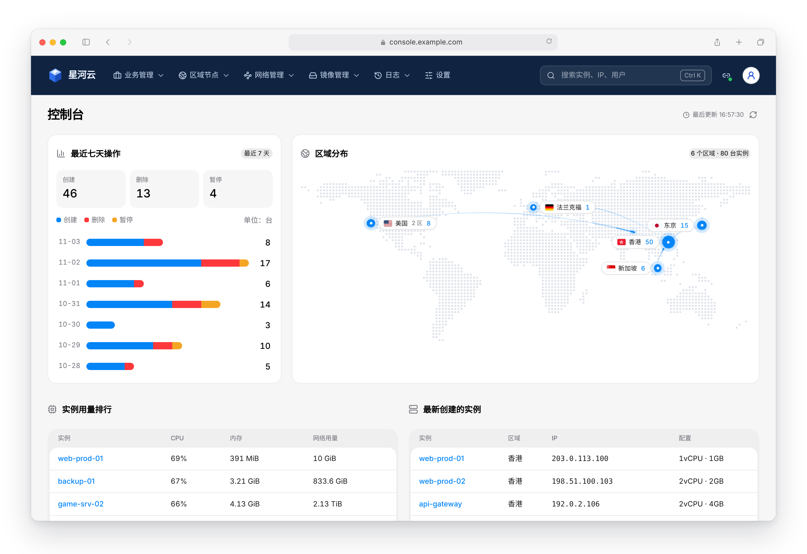
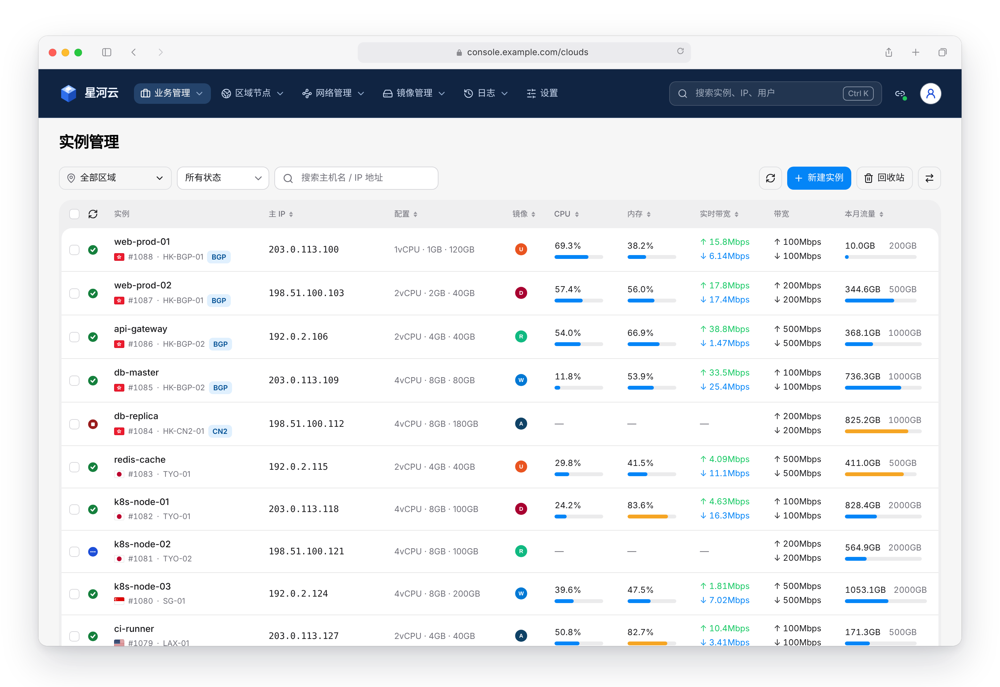
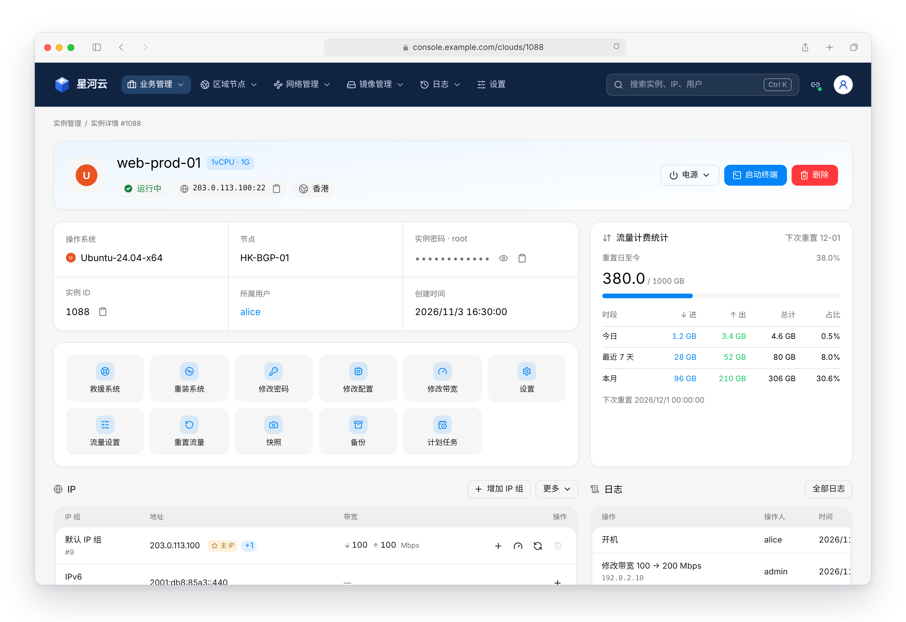
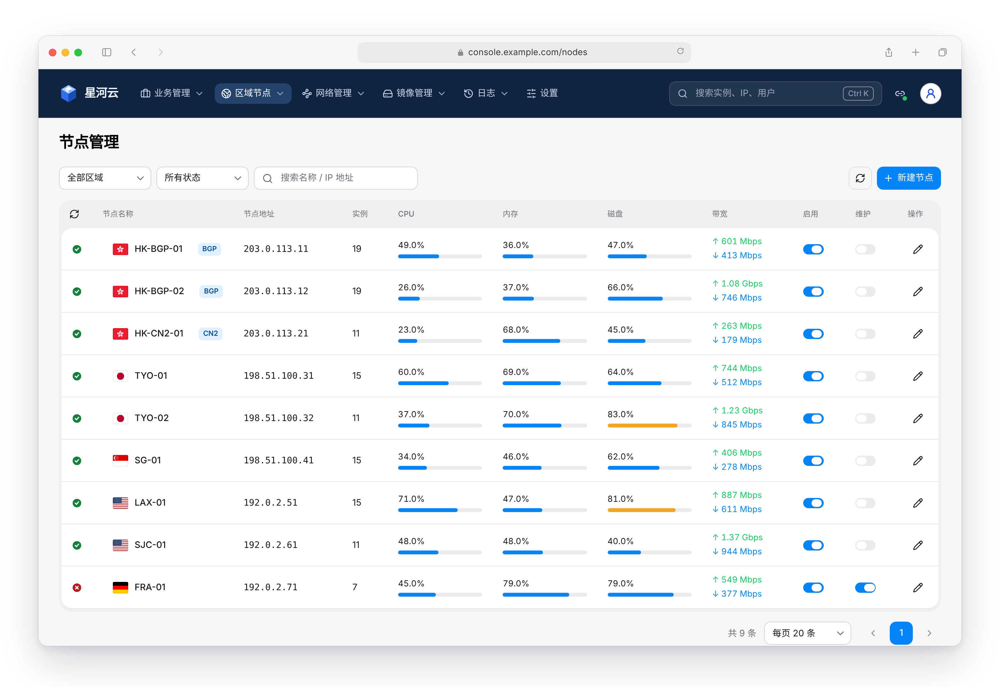

<p align="center">
  <a href="https://digitalvirt.com/opensource/cubemanage">
    <picture>
      <source media="(prefers-color-scheme: dark)" srcset=".github/assets/digitalvirt-logo-light.svg">
      
    </picture>
  </a>
</p>

# CubeManage

> 由 **DigitalVirt** 开发并开源，基于 [MIT 许可证](LICENSE) 发布。项目介绍：[digitalvirt.com/opensource/cubemanage](https://digitalvirt.com/opensource/cubemanage)

CubeManage 是一个通过 **魔方云虚拟化平台 API** 管理云实例的控制台，用 Vite 8 + React 19 + HeroUI 开发。实例、用户、区域节点、网络、镜像和日志都能在一个界面里管理；前端只和本地 Node 服务通信，平台凭据和令牌不会发送到浏览器。



> 截图中的「星河云」是演示用的网站名称，实际显示魔方云后台网站配置里的名称。

## 特点

- **凭据不落盘**：密码只用来换取平台 token；会话用 AES-256-GCM 加密后保存在浏览器的 HttpOnly Cookie 里，服务端不保存任何凭据，也不需要数据库。
- **覆盖魔方云常用后台**：实例、用户、VPC 网络、磁盘、安全组、实例模板、SSH 密钥、区域节点、IPv4 / IPv6、ADSL、镜像 / ISO、日志与网站配置。
- **19 项批量操作**：重启、重装、迁移、替换 IP 等批量操作全部接入，提交前核对数量，结束后逐台汇总成功与失败。
- **全局搜索**：⌘K / Ctrl+K 同时搜索实例主机名、IP、编号和用户，回车直达详情。
- **一屏看清全局**：控制台汇总最近七天操作、区域分布地图、实例用量排行和最新创建的实例。
- **链接即现场**：页码、筛选、搜索和排序都写进网址，刷新、后退或分享链接都回到同一位置。

| 实例管理 | 实例详情 | 区域节点 |
| --- | --- | --- |
|  |  |  |

## 技术栈

- 前端：Vite 8、React 19、HeroUI v3、Tailwind CSS 4、React Router 7、TypeScript
- 服务端：Node.js 22 + Express 5，代理请求魔方云 API 并管理加密会话

## 部署方式

| 方式 | 状态 |
| --- | --- |
| 自行安装（Node.js） | 已支持 |
| Docker | 已支持，镜像 [`digitalvirtllc/cubemanage`](https://hub.docker.com/r/digitalvirtllc/cubemanage) |
| macOS 客户端 | [下载](https://github.com/DigitalVirt/CubeManage/releases/latest)（Apple 芯片 / Intel） |
| Windows 客户端 | [下载](https://github.com/DigitalVirt/CubeManage/releases/latest)（64 位） |

### 自行安装

需要 Node.js 22.12 或更高版本。

```bash
npm install
npm run build
npm start        # 默认监听 127.0.0.1:5080
```

开发调试用 `npm run dev`，同时启动服务端和 Vite。可复制 `.env.example` 为 `.env` 修改监听地址、端口等非敏感设置。

### Docker

不想安装 Node 的话，用 Docker 一条命令就能运行。镜像已发布到 Docker Hub（[digitalvirtllc/cubemanage](https://hub.docker.com/r/digitalvirtllc/cubemanage)），包含 Node 和打包好的页面，支持 amd64 和 arm64：

```bash
docker run -d --name cubemanage -p 5080:5080 --restart unless-stopped digitalvirtllc/cubemanage:latest
```

或者下载仓库里的 [`docker-compose.yml`](docker-compose.yml) 后运行 `docker compose up -d`。想从源代码自己构建镜像：

```bash
docker compose up -d --build
# 或者
docker build -t cubemanage .
docker run -d --name cubemanage -p 5080:5080 --restart unless-stopped cubemanage
```

然后在浏览器打开 `http://服务器IP:5080`。

- 服务端不保存任何用户信息、不写日志文件，容器不需要挂载数据卷。重启容器后所有人需要重新登录（会话密钥只在内存里）。
- 对公网开放时，请在前面加 HTTPS 反向代理（Nginx、Caddy 等），不需要其他配置：程序会识别代理传来的 HTTPS 和原始域名，会话 Cookie 自动带上 Secure。
- 平台使用 JSON 请求体时，设置 `CUBE_BODY_ENCODING=json`。
- 如果平台的管理接口限制了来源 IP，需要把运行 CubeManage 的服务器 IP 加入白名单。
- 升级：`docker pull digitalvirtllc/cubemanage:latest` 后重新创建容器（Compose 用 `docker compose pull && docker compose up -d`）。也可以把 `latest` 换成版本号（如 `0.1.69`）固定版本。
- 依赖由 pnpm 管理（`pnpm-lock.yaml`），镜像构建时通过 corepack 使用 `package.json` 里指定的 pnpm 版本。
- **发布镜像**：推送 `v` 开头的标签，或在 Actions 页面手动运行 “Docker”，会构建 amd64 / arm64 镜像并推送到 Docker Hub（版本号和 `latest` 两个标签）。需要先在仓库 Secrets 里配置 `DOCKERHUB_USERNAME` 和 `DOCKERHUB_TOKEN`；镜像名默认 `digitalvirtllc/cubemanage`，可以用仓库变量 `DOCKERHUB_IMAGE` 修改。

### macOS / Windows 客户端

客户端基于 Electron，把页面和本机服务打包在一起：双击打开即可使用，不需要安装 Node，也不需要配置 HTTPS。服务只在本机 `127.0.0.1` 上运行，请求直接从你的电脑发往平台。安装包在 [Releases](https://github.com/DigitalVirt/CubeManage/releases) 页面下载，也可以自己打包：

**更新提示**：客户端启动后和每隔 6 小时会检查 GitHub Releases，有新版本时弹窗显示版本号和更新内容，可以“下载更新”（用浏览器下载对应系统和芯片的安装包）、“查看更新内容”、“稍后提醒”或“跳过这个版本”。也可以手动检查：macOS 在菜单栏“CubeManage → 检查更新…”，Windows 在页面右上角个人菜单里点“检查更新”。下载后关闭客户端，安装新版本覆盖即可，登录页保存的平台地址会保留。因为安装包没有开发者证书签名，macOS 上无法后台自动安装，所以采用提示下载的方式。

安装包暂未使用 Apple 开发者证书签名。macOS 第一次打开时如果提示“无法验证开发者”，到“系统设置 → 隐私与安全性”点“仍要打开”；如果提示“已损坏，无法打开”，在终端运行 `xattr -cr /Applications/CubeManage.app` 后再打开。Windows 出现“Windows 已保护你的电脑”时，点“更多信息”→“仍要运行”。

```bash
pnpm desktop        # 构建页面并打开桌面窗口（调试用）
pnpm desktop:dist   # 打包安装包，输出到 release/（macOS 上生成 .dmg，Windows 上生成 .exe）
```

- **自动打包与发布**：推送 `v` 开头的标签（如 `git tag v0.1.69 && git push --tags`），或在 Actions 页面手动运行 “Desktop” 并勾选“发布 Release”，GitHub Actions 会在 macOS 和 Windows 上分别打包，然后按版本号创建 Release 并附上安装包。Release 正文取自 `.github/release-notes/v<版本号>.md`。只手动运行、不勾选时，安装包在本次运行的 Artifacts 里下载。
- **签名（可选）**：在仓库 Secrets 里配置证书后自动签名，macOS 还会公证，变量见 `.github/workflows/desktop.yml` 开头。未签名的安装包也能用，但 macOS 首次打开需要在“系统设置 → 隐私与安全性”里允许，Windows 会提示“未知发布者”。
- 图标在 `build/icon.png`（1024×1024），打包配置在 `electron-builder.yml`。

## 连接平台

打开页面，在登录页填写魔方云平台地址（包含实际的管理目录，无需添加 `/v1`）、用户名和密码。请求编码默认为表单，可在 `.env` 中用 `CUBE_BODY_ENCODING=json` 修改。

登录成功后，平台地址会保存在当前浏览器的 localStorage 里（只保存地址，不保存用户名、密码和令牌，最多 10 个）。下次登录时默认选中最近一次的地址，也可以从下拉框选择其他平台，或选“输入新的平台地址”；不再需要的地址可以“从列表中移除”。

### 凭据与会话

- **密码只用一次**：密码只用于向平台换取 access-token，换到后立即丢弃，不写入文件、环境变量、日志或 Cookie。
- **会话只在浏览器里**：平台地址、用户名、平台 token、有效期和 CSRF 令牌，用 AES-256-GCM 加密成一个 Cookie，只保存在登录者的浏览器里。这个 Cookie 是 HttpOnly 的，页面脚本读不到；设置了 SameSite=Strict；通过 HTTPS 访问（包括经反向代理）时自动带 Secure。内容加密且防篡改，即使 Cookie 被复制也看不到明文。
- **服务端不留会话**：服务端不保存任何会话或凭据。加密密钥只在服务进程的内存里，从不落盘，所以重启服务后所有人都要重新登录。
- **时效跟随平台 token**：Cookie 的有效期等于平台 token 的有效期（平台未返回时按文档的一天计算）。平台一旦返回 401，会话立即结束并清除 Cookie，页面回到登录。期间不会用密码静默重新登录。
- **退出即注销**：退出时调用平台 `v1/logout` 注销 token，并在服务端记住这个会话已退出，直到它原本的到期时间，所以复制出去的旧 Cookie 也会失效。
- **本机不记操作日志**：服务端不写任何操作记录文件，操作记录以平台自己的日志为准（日志菜单里的系统、登录、任务日志）。

## 验证

```bash
npm test
npm run build
```

实际平台的接口和字段可能因版本不同而异，使用写操作前请先在测试环境验证。

## 管理功能

顶栏左侧 LOGO 返回首页（控制台），LOGO 旁显示设置里的网站名称（网站配置 → 基本信息，平台字段 `company_name`；未设置时显示 CubeManage）。名称缓存在浏览器 localStorage 中，下次打开先显示缓存再向平台刷新，缓存只记平台地址的指纹；保存网站配置后立即更新。导航依次为业务管理（实例管理 / 用户管理）、区域节点、网络管理（管理 IPv4 / 管理 IPv6 / ADSL 维护）、镜像管理（镜像 / ISO）、日志菜单和设置；连接设置从顶栏右侧的连接状态图标进入。

设置页（`/system`）用横向 Tab 展示并编辑平台“网站配置”接口的内容：基本信息、实例与磁盘、安全、通知、IP、内网 IP、流量与节点流量、DDNS、VNC、功能开关、vGPU、疏散（只读）、升级源和调试。保存前确认改动，只提交修改过的字段；密码和密钥不会发送到浏览器，留空即保持原值。这些都是平台全局配置，修改端口或管理员路径前请确认影响。日志菜单提供系统、登录、任务、ADSL、日志清理及黑名单记录；独立任务中心入口已合并到日志菜单。

业务管理下拉除实例管理和用户管理外，还有：VPC 网络（接口名称、节点、出口 MAC、网段、网内主机、所属用户；改名、删除，不支持多选）、磁盘管理（只看列表和新建，没有勾选列和操作列；“回收站”按钮进入单独的磁盘回收站页面，可恢复、彻底删除）、安全组（新建、修改、删除、关联 / 解除关联实例，规则的增删改；不支持多选）、实例模板（从实例创建、删除；不支持多选）、密钥管理（自动生成或导入 SSH 密钥、绑定 / 解绑实例、删除；不支持多选）。自动生成的私钥只在创建后显示一次，不写入本机日志。

网络管理下拉包含三页，接口均来自 `digitalvirt-v1-api.md`：

- **管理 IPv4**（`/ipv4`）：首页为 IP 段列表（名称、节点、锁定 / 已用 / 空闲 / 总数各一列，最后是分组），点击名称进入该段的 IP 地址，新建按钮右侧的“分组”进入 IP 分组。IP 段可按区域 / 节点、状态、分组筛选，新建、编辑、批量修改（分组、可用节点、onlink）和删除（`v1/ipSegment`）；修改网关时先列出需要重启的实例（`need_reboot_host`），再选择手动或自动重启。IP 地址按 IP 段列出，可按起止地址批量添加、编辑 VLAN / MAC / 备注 / 锁定、批量修改和删除（`v1/ip`）。IP 分组管理名称、描述和包含的 IP 段（`v1/ip_groups`）。
- **管理 IPv6**（`/ipv6`）：结构同 IPv4，点击段名称查看地址，“分组”进入 IPv6 分组。IPv6 段按地址块或起止地址添加，可编辑网关、DNS、分组、可用节点并删除（`v1/ipv6_segments`）；IPv6 地址只读，列出分配给哪个实例（`v1/ipv6`）；IPv6 分组同 IPv4（`v1/ipv6_groups`）。
- **ADSL 维护**（`/adsl`）：拨号账号列表，可按区域 / 节点、使用状态、锁定筛选，新建、编辑、批量修改、批量导入（每行 `VLAN,账号,密码,节点ID…`，`POST v1/adsls`）和删除（`v1/adsl`）。账号密码不会发送到浏览器，编辑时留空即保留原密码。

删除时服务端核对所选数量，平台拒绝的记录（如仍在使用的 IP、账号）逐条列出原因。

镜像和 ISO 支持列表、搜索、状态筛选、新建、编辑和编号确认删除。用户支持账号及联系方式管理；初始密码仅在新建时提交。用户列表的“实例”数量可点击，打开只显示该用户实例的实例列表。日志清理先查询指定类型和截止时间对应的数量，再通过确认文字提交删除。

顶栏中间为全局搜索（macOS 按 ⌘K，其他系统按 Ctrl+K），输入时调用平台 `v1/global_search`，同时匹配实例（主机名、IP、编号）和用户。点击或回车打开结果：实例进入详情页，用户进入实例列表并只显示该用户的实例（平台 `v1/clouds` 的 `user` 参数），筛选栏的“用户”标签可一键移除；未选中结果时按回车，跳转到实例列表并带上关键字。

实例管理页右上角的“回收站”按钮进入回收站：可搜索已删除的实例，查看放入时间和到期删除时间，单个或批量恢复、彻底删除（平台 `v1/recycle_bin` 与 `v1/clouds/recycle_bin` 接口）。

实例列表的“新建实例”进入独立页面 `/clouds/new`：位置、镜像、规格、网络、登录、实例信息六个分区，右侧吸顶显示配置摘要和创建按钮（`v1/clouds/create_page`、`v1/node_images`、`POST v1/clouds`）。新建 / 编辑区域与节点使用左侧分组导航的宽弹窗。

实例列表的主 IP、配置、镜像、CPU、内存、实时带宽、本月流量可点击表头排序（平台 `v1/clouds` 的 `orderby` / `sort`，写入网址；本月流量平台不支持，只对当前页排序）。实例列表支持勾选后批量操作，菜单顺序与魔方云后台一致，19 项均已接入（取消迁移在迁移队列弹窗里）：重启、硬重启、开机、关机、硬关机、解除挂起、暂停、取消暂停和迁移逐个调用单实例接口（迁移每台单独发起 `POST v1/clouds/:id/migrate`，不走批量迁移队列）；重置密码、强制删除、删除、实例设置、重装、规则应用、添加 IPv6、替换 IP、一键重建实例调用平台的批量接口；导出下载平台生成的 CSV。弹窗列出所选实例，提交时服务端核对实例数量，防止列表已变化；结束后按实例汇总成功与失败，随机密码只显示一次。

实例详情页的操作区还有：设置（启动盘、启动顺序、ISO 挂载、CPU 模式与限制、CPU 拓扑 / CPUTune / NUMA、VNC 与串口控制台、ACPI、时钟、QEMU 版本、VirtIO-GPU、网卡多队列、跳过冷备份、查看 XML；APIC 平台不支持修改，只读；控制台密码只在点“显示”时读取）、快照、备份（创建、还原、删除、取消创建）、计划任务（定时快照 / 备份）。实例详情页提供电源操作、网页终端、救援系统、重装、修改密码 / 配置 / 带宽、流量设置与重置，以及网络（IPv4 / IPv6、主 IP、VPC、断网）、磁盘、监控图表和实例日志。界面规范见 `DESIGN.md`。

## 开源声明

CubeManage 由 DigitalVirt 开发，并以 [MIT 许可证](LICENSE) 开源：可以自由使用、修改和分发（包括商业用途），只需保留版权和许可声明。

- 欢迎通过 [Issues](https://github.com/DigitalVirt/CubeManage/issues) 反馈问题和建议，或提交 Pull Request。
- 本项目按“现状”提供，不附带任何担保。管理的是生产环境中的云资源，使用写操作（删除、重装、迁移等）前请先在测试环境验证。

## 版本号

版本号只在 `package.json` 里维护，登录页和页面底部显示的 `vX.Y.Z`、请求平台时的 User-Agent 都从这里读取。每次修改功能或界面，把最后一位（修订号）加 1，例如 `0.1.1` → `0.1.2`；改动较大时再加中间一位。

| 版本 | 内容 |
| --- | --- |
| 0.1.86 | 节点详情信息带顺序调整为：区域、节点名称、分组、节点类型、节点版本、运行时间、开机自启、节点启用、维护模式、实例数量、IP 使用（不再显示节点 ID） |
| 0.1.85 | 节点详情页头部改为一张白色卡片（去掉蓝色渐变）：左侧用图标显示节点状态，标题为节点 IP；下方信息带合并原概况，显示节点名称、节点 ID、区域、分组、节点类型、版本（节点状态接口）、实例数量、IP 使用、运行时间，以及维护模式、节点启用、开机自启三个开关（点一下即通过修改节点接口只提交这一项）；去掉创建 / 更新时间，节点信息中不再重复这三项 |
| 0.1.84 | 节点详情页布局：顶部蓝色区域 → 概况 → CPU / 内存 / 磁盘一行三个 → 节点信息，全部通栏；修复概况卡片沿用实例详情网格区域导致不通栏；不再在详情页列出节点上的实例（顶部“查看节点实例”跳到实例列表） |
| 0.1.83 | 节点详情页（/nodes/:id）：节点列表点击节点名称进入。合并平台节点详情、节点内容页和节点实时数据三个接口，显示状态、IP、区域与分组、实例数、IP 使用、运行时间，CPU（使用率、型号、核心线程、负载、已分配 vCPU）、内存与 Swap、各磁盘用量，内核与 QEMU 版本、授权方式、维护模式、疏散、NAT、DNS、备份路径、GPU、网关 MAC 等节点信息，以及节点上的实例（前 10 台，可跳转查看全部）；SSH 密码、密钥等敏感字段不返回浏览器 |
| 0.1.82 | 批量提交进度列表（批量迁移、取消迁移等）按原顺序显示，自动滚动让当前正在提交的那一行始终可见 |
| 0.1.81 | 实例刷新状态时，行首状态图标位置显示转动的圆环（纯 CSS：灰色底环 + 五分之二蓝色圆弧，16px，原为刷新图标） |
| 0.1.80 | 实例列表右上角工具栏的“刷新”也改为只更新本页实例的实时状态、CPU、内存和带宽（每 5 个一批），不再重新加载列表、不出现骨架屏 |
| 0.1.79 | 实例列表表头刷新每 5 个实例一批：并发获取实例状态，同时用一个 v1/clouds/real_data 请求更新这 5 个实例的 CPU、内存和实时带宽 |
| 0.1.78 | 实例列表表头的刷新按钮改为刷新本页实例的实时状态：逐个调用平台实例状态接口，每次 5 个，状态图标逐行更新，不再重新加载整个列表；获取失败的数量会提示 |
| 0.1.77 | 迁移队列进度列不再显示目标节点 |
| 0.1.76 | 迁移队列：有实际进度的实例排在最上面（进度高的在前），然后是正在迁移但还没进度的，最后是排队中的；进度条上方左侧显示已迁移 / 总大小，右侧显示速度和剩余时间；没有进度时留空 |
| 0.1.75 | 迁移队列进度：冷迁移进度接口在热迁移时只返回 0，这时改用任务列表（v1/tasks）中该实例迁移任务的进度和描述；迁移任务还没开始执行的实例显示为排队中；进度兼容“42%”这类字符串 |
| 0.1.74 | 桌面客户端更新提示：启动 8 秒后和每 6 小时检查 GitHub Releases，有新版本时弹窗显示更新内容，可下载对应系统和芯片的安装包、查看更新内容、稍后提醒或跳过这个版本；macOS 应用菜单和 Windows 个人菜单可手动检查更新（preload 只暴露检查更新一个接口） |
| 0.1.73 | 登录页记住平台地址：登录成功后地址保存在浏览器 localStorage（只保存地址，最多 10 个，最近的在前），下次登录从下拉框选择，默认选中最近一次，可输入新地址或从列表中移除；没有保存的地址时照常输入 |
| 0.1.72 | 实例列表：国旗、节点、分组从实例名称下方移到“配置”下方，分组标签缩小；实例名称下方 ID 后显示实例所有人账号，点击只看该用户的实例 |
| 0.1.71 | 批量操作显示进度：取消迁移和实例列表的批量操作每 10 个实例一批提交，逐个显示排队中 / 正在提交 / 已提交 / 失败，可在两批之间停止；迁移队列在取消期间暂停刷新，查询迁移进度最多同时 6 个请求；平台写操作超时放宽到 120 秒（读取 30 秒），超时与连接失败分开提示，超时会说明操作可能仍在平台执行 |
| 0.1.70 | 批量操作一次最多可选 1000 个实例（原来 100 个）：平台批量接口（取消迁移、删除、重装、重置密码、恢复 / 彻底删除、规则、IPv6、替换 IP、实例设置、一键重建）每次最多 100 个，超过时按 100 个一批依次提交并合并结果；某一批失败只标记该批实例，登录过期时立即停止 |
| 0.1.69 | 新增桌面客户端（Electron）：本机运行服务并打开窗口，外部链接用系统浏览器打开，只允许一个实例；electron-builder 打包 macOS（dmg，arm64 / x64）与 Windows（nsis 安装包），GitHub Actions 自动打包并发布 Release；前端依赖移到 devDependencies，运行依赖只剩 express、dotenv |
| 0.1.68 | 去掉 `APP_ORIGIN` 配置：程序信任本机 / 局域网 / Docker 内网上的反向代理，自动识别 HTTPS（Cookie 带 Secure）和原始域名（来源校验），任何部署方式都无需配置 |
| 0.1.67 | 新增 Docker 部署：Dockerfile（两阶段构建，运行阶段只带运行依赖和打包好的页面，以非 root 用户运行，带健康检查）、docker-compose.yml、.dockerignore；package.json 指定 pnpm 版本 |
| 0.1.66 | 不再转圈：打开网站检查登录状态时显示顶栏 + 页面骨架，全局搜索中显示结果骨架；没有登录状态或会话过期时提示并回到登录页；首页改名为“控制台” |
| 0.1.65 | 每个页面设置浏览器标签页标题“页面名 - 网站名称 - CubeManage 云管控制台”（未设置网站名称时省略中间一段），子视图（IP 地址、IP 分组、安全组规则等）和实例详情（主机名）各有自己的标题 |
| 0.1.64 | 去掉页面里的转圈加载，改为骨架屏（列表页、首页、系统设置、新建实例、详情弹窗、实例日志）；只有列表类页面才等待字段描述，其他页面直接渲染；首页“最后更新 + 刷新”移到标题行最右侧并上下居中；所有页面标题上下边距统一为 20px |
| 0.1.63 | 首页标题行按规范只放标题：去掉“刷新”“管理实例”按钮，刷新改为页面底部“最后更新”旁的小图标 |
| 0.1.62 | 区域连线动效改为渐隐光轨 + 带拖尾的双向流光 + 圆点涟漪，连线只连到实例最多的区域；首页上排卡片内边距缩小 |
| 0.1.61 | 区域分布：标签前加国旗；区域之间加弧形连线动效（流动虚线 + 双向光点），减少动态效果时只显示静态连线 |
| 0.1.60 | 首页最近七天操作改为最新的一天显示在最上面 |
| 0.1.59 | 修复首页下排两张表行高不一致：行高固定 44px，IP 复制按钮不再撑高行 |
| 0.1.58 | 首页下排两张表都显示 8 条；“最新创建的实例”去掉状态列 |
| 0.1.57 | 首页下排两张表统一样式：首列都为“实例”主色链接、行高和数字样式一致、各最多 6 行，去掉“全部实例”按钮 |
| 0.1.56 | 首页“最新创建的实例”的配置只显示 vCPU 和内存，不显示磁盘 |
| 0.1.55 | 首页“最新创建的实例”的区域列去掉国旗，只显示区域名 |
| 0.1.54 | 地图悬停卡片改为版本 A：实例数大号突出、节点数一行小字，多区域逐行列出并配占比细条，不用分隔线 |
| 0.1.53 | 首页上排左右两栏各自用白底浅边框卡片包裹，上下排之间去掉分隔线，下排也去掉说明文字；地图悬停卡片改为标题 + 节点 / 实例两格数字，合并区域时逐行列出 |
| 0.1.52 | 首页上排改为白底浅边框整体包裹，只保留区块标题；区域分布按国家 / 地区合并，同一国家多个区域显示为一个点（标签为合计实例数与区域数），悬停卡片只显示区域、节点数、实例数，点击进入区域列表 |
| 0.1.51 | 首页改版：上排左 1/3 为最近七天操作（三项合计 + 每天堆叠横条），右 2/3 为区域分布点阵世界地图（区域圆点按实例数缩放、常驻标签，点击进入该区域节点）；下排左为实例用量排行，右为最新创建的实例（主机名、区域、IP、配置、状态） |
| 0.1.50 | 所有页面底色改为 #F6F6F6（含登录页） |
| 0.1.49 | 去掉本机操作日志：服务端不再写 `.data/audit.jsonl`，删除“操作日志”页面和 `/api/audit`，操作记录以平台日志为准 |
| 0.1.48 | 实例详情操作区改为 6 列图标磁贴，新增设置、快照、备份、计划任务：设置弹窗为左侧分组导航（启动与引导、CPU、CPU 高级、控制台、硬件与虚拟化、备份与诊断），只提交改动项；快照 / 备份可创建、还原、删除、取消创建；计划任务管理定时快照 / 备份 |
| 0.1.47 | 实例详情页去掉粗体，页内文字统一常规字重 |
| 0.1.46 | 流量计费统计改为方案 C：重置日至今汇总（已用 / 限额 + 进度条），下方表格列出今日、最近 7 天、本月的进、出、总计与占比（`v1/net_info`） |
| 0.1.45 | 实例详情基本信息新增实例 ID（可复制）、所属用户（点击查看该用户的实例）、创建时间；“流量概况”改名“流量计费统计”；去掉首行右侧的 CPU 使用率卡片 |
| 0.1.44 | 撤回基本信息内部小框；改为实例详情上半部分卡片（页头、基本信息、流量概况、操作、CPU）外框加浅色边框 |
| 0.1.43 | 实例详情基本信息的三项（操作系统、节点、实例密码）各加浅色边框 |
| 0.1.42 | 实例详情页头渐变改为从左上到右下 |
| 0.1.41 | 实例详情页头卡片加由上到下的浅蓝到白色渐变背景 |
| 0.1.40 | 排序三角缩小为 6×4px，间距 1px |
| 0.1.39 | 修复排序三角被 HeroUI 按钮的 svg 样式放大（固定为 8×5px，去掉外边距） |
| 0.1.38 | 实例列表排序表头改为方案 B：整个表头格可点，常驻上下小三角，当前方向变蓝 |
| 0.1.37 | 实例列表的 主 IP、配置、镜像、CPU、内存、实时带宽、本月流量 可点击表头排序（排序写入网址）；本月流量平台不支持排序，只对当前页排序 |
| 0.1.36 | 业务管理各页的 IP 加悬停复制按钮：VPC 网段、密钥管理的实例 IP（含 tooltip 里的其余 IP）、绑定 / 解绑 / 关联实例弹窗里的主 IP |
| 0.1.35 | 密钥管理列表去掉多选，列改为 ID · 密钥名称 · 用户 · 实例（标签，显示第一个，其余在 tooltip）· 实例 IP · 创建时间 · 操作（绑定、解绑、删除），绑定与解绑拆为两个弹窗 |
| 0.1.34 | 实例模板列表去掉多选，列改为 ID · 状态（图标）· 名称 · 存储节点（浅蓝节点标签，下行存储）· 大小 · 用户 · 创建时间，去掉源实例列 |
| 0.1.33 | 安全组列表去掉多选，列改为 ID · 安全组名称（下行描述）· 节点类型 · 关联数量（浅蓝标签，悬停列出关联实例并可进入详情）· 所属用户 · 规则数量 · 创建时间 · 操作（修改、删除、关联实例、配置规则）；新增关联 / 解除关联实例 |
| 0.1.32 | 磁盘管理去掉操作列，右上角按钮改为“新建”，旁边新增“回收站”进入单独页面“磁盘回收站”（`/disk-recycle`：恢复、彻底删除）；状态筛选去掉“回收站” |
| 0.1.31 | 磁盘管理列表去掉多选，列改为 ID · 磁盘名称 · 存储（浅蓝标签）· 源镜像 · 磁盘大小 · 实际占用 · 挂载实例 · 所属用户 · 跟随实例（只读开关）· 备份 / 快照 |
| 0.1.30 | VPC 网络：网段标签文字与出口 MAC 一致（等宽、浅灰色、12px） |
| 0.1.29 | VPC 网络：出口 MAC 地址改为浅灰色、12px |
| 0.1.28 | VPC 网络：节点名称从出口 MAC 下方移出，作为标签单独一列，排在接口名称后面 |
| 0.1.27 | VPC 网络列表去掉多选，列改为 接口名称 · 出口 MAC 地址 · 网段（标签）· 网内主机（标签，显示第一个，其余在 tooltip 里，点击进入实例详情）· 所属用户 |
| 0.1.26 | 业务管理下的“网络管理”改名为“VPC 网络”，避免与顶部网络管理下拉重名 |
| 0.1.25 | 业务管理下拉新增网络管理（VPC 网络）、磁盘管理、安全组（含规则）、实例模板、密钥管理（SSH 密钥） |
| 0.1.24 | 新建 / 编辑区域与节点弹窗加宽到 56rem |
| 0.1.23 | 新建 / 编辑区域与节点改为左侧分组导航的宽弹窗，节点补充分组、可用 IP 段、NAT 端口、存储规则、自动开机等字段；新建实例改为独立页面（/clouds/new，单页分区 + 右侧配置摘要） |
| 0.1.22 | 节点地址加悬停复制按钮；节点 CPU、内存进度条撑满单元格；列表里进度条上方的数值改为常规字重、13px |
| 0.1.21 | 系统 / 登录日志过滤 HTML 标签，原标签内的文字改为主色显示；系统日志的操作人和 IP 地址移到最后两列 |
| 0.1.20 | 状态图标恢复为实心圆加白色符号（取消 soft 样式） |
| 0.1.19 | 恢复原立方体 LOGO；实例、节点、区域、任务状态图标统一为 soft 样式（浅色圆底 + 状态色符号）；设计规范页加左侧目录侧边栏，补齐今天调整的导航、列表页、勾选列、确认弹窗等规范 |
| 0.1.18 | 重新制作 LOGO：2.5D“Cube Cloud”，立方体从云中升起，配色沿用原 LOGO |
| 0.1.17 | 顶栏下拉菜单颜色调浅；头像图标线条加深加粗 |
| 0.1.16 | 右上角头像改为白色圆底、蓝色线性用户图标 |
| 0.1.15 | 顶栏下拉菜单改为深海蓝色调，与导航栏一致 |
| 0.1.14 | 导航新增“业务管理”下拉（排第一位），收纳实例管理和用户管理 |
| 0.1.13 | 节点启用 / 维护确认窗只保留提醒，取消和确认按钮加宽 |
| 0.1.12 | 节点列表的启用 / 维护开关改为只需“取消 / 确认”的弹窗，不再输入编号；弹窗内容整理为节点信息、状态变化和影响说明 |
| 0.1.11 | 节点列表的 CPU、内存、磁盘进度条宽度改为撑满单元格 |
| 0.1.10 | 所有列表的勾选列统一为 HeroUI Checkbox（`table-check`）并取最小宽度：实例列表、回收站、迁移队列、网络管理 |
| 0.1.9 | 所有列表页的工具栏：筛选和搜索在左，刷新、新建和其他按钮靠右；去掉工具栏右侧的说明文字（规则见 DESIGN.md「列表页」） |
| 0.1.8 | 列表页统一：标题行只放标题（去掉数量徽标），搜索、刷新、新建和其他按钮依次排在筛选下拉右侧；规则写入 DESIGN.md「列表页」和设计规范页。IPv4 段列表去掉状态列，列顺序为 名称 · 节点 · 锁定 · 已用 · 空闲 · 总数 · 分组，勾选列取最小宽度，空节点不显示 |
| 0.1.7 | IPv4 / IPv6 管理去掉 Tab：段列表只保留分组、名称、节点和各项数量列（不显示网段、DNS），点击名称进入 IP 地址，新建右侧的“分组”按钮进入分组 |
| 0.1.6 | 移除演示模式：删除内存模拟数据（`server/demo.mjs` 及网站配置、网络管理的演示数据）、`npm run demo` 脚本、登录页演示提示、顶栏演示标识和横幅；相关测试改为模拟平台接口 |
| 0.1.5 | 页头显示网站配置里的网站名称（`company_name`），缓存在浏览器本地，保存网站配置后自动更新；页头下拉菜单改为纯文字 |
| 0.1.4 | 新增“网络管理”下拉：管理 IPv4（IP 段 / IP 地址 / IP 分组）、管理 IPv6（IPv6 段 / IPv6 地址 / IPv6 分组）、ADSL 维护（含批量导入） |
| 0.1.3 | 列表的页码、每页条数、搜索和筛选写入网址（`?page=2&per_page=50&status=on&search=web&area=1&node=12`），刷新、后退或分享链接都回到同一位置 |
| 0.1.2 | 凭据不再保存在本机：密码只用于登录，会话加密保存在浏览器的 HttpOnly Cookie 中，时效跟随平台 token，退出时注销 token；操作日志不再记录平台地址和用户名明文 |
| 0.1.1 | 迁移队列弹窗、批量迁移逐台提交并显示进度、区域 / 节点级联筛选、任务状态图标、HeroUI Toast、实例当前任务显示、IP 组删除、修改配置改为 MB 档位等 |
